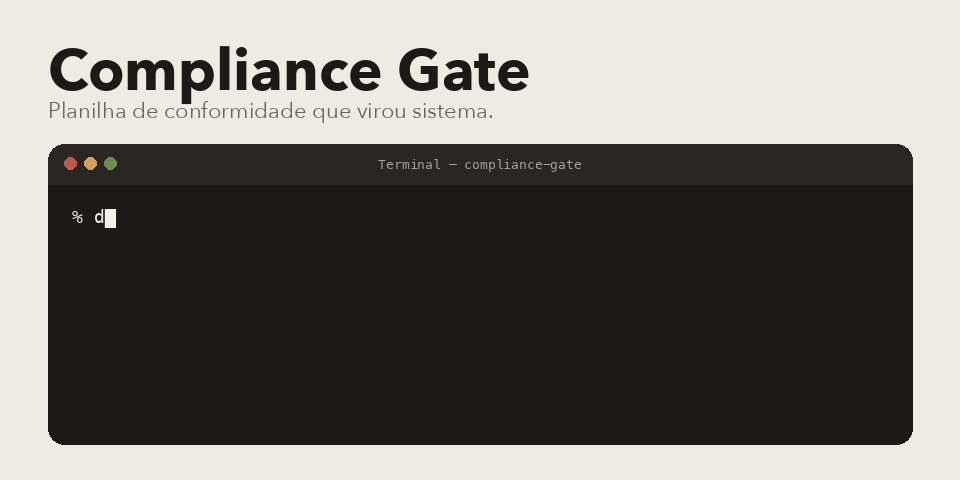

<p align="center">
  
</p>

Compliance Gate tira a conformidade de dentro da planilha. O arquivo entra, o backend lê o cabeçalho, processa, e o front só mostra o que já veio pronto.

## Do que é feito

Python 3.12. FastAPI, Pydantic, SQLAlchemy e Alembic, com PostgreSQL. Polars e DuckDB para mastigar tabela. Celery e Redis para o que não pode travar o pedido. Login local com JWT e MFA por TOTP, no estilo do autenticador, com dois papéis: `TI_ADMIN` e `DIRECTOR`.

O front é React 18, Vite, TanStack Router, TanStack Query, Tailwind e Zustand. Mora em `frontend/`.

## Subir

```bash
docker compose up -d
```

A API fica em http://localhost:8000. No primeiro uso dá para criar o admin pelas variáveis `AUTH_BOOTSTRAP_ADMIN_USERNAME` e `AUTH_BOOTSTRAP_ADMIN_PASSWORD`, e entrar em `POST /api/v1/auth/login`.

O front, na pasta dele:

```bash
cd frontend
npm install
npm run dev
```

Na mão, o backend:

```bash
python3 -m venv .venv
source .venv/bin/activate
pip install -e ".[dev]"
```

O detalhe do login, do TOTP e da troca de senha sem e-mail está em `notes/auth_core_v1.md`.

## Onde mexer

- `src/compliance_gate/` é a API.
- `frontend/src/` é a tela e a sessão.
- `docker-compose.yml` sobe API, Postgres e Redis.

Pedro Américo Paletot, [peamericoo](https://github.com/peamericoo).
